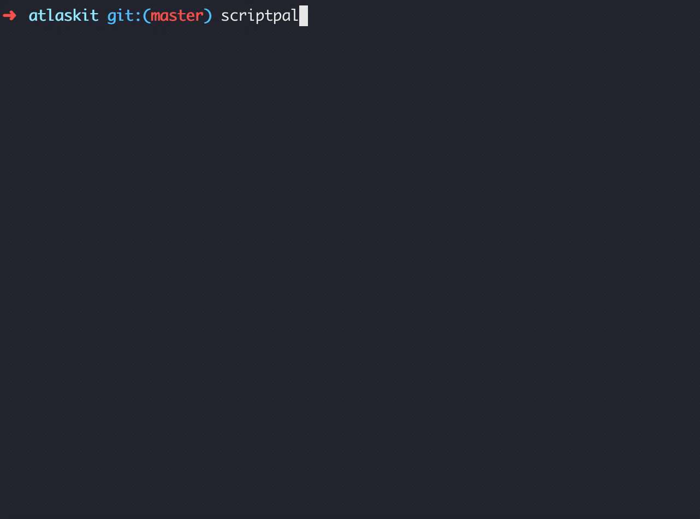

<p align="center">
  
</p>

# ScriptPal 🤘

A simple npm script palette for lazy people who want a quick way to look through and pick npm scripts!

- keyboard navigation
- autocompletion
- fuzzy finding
- bookmarks

<p align="center">
  
</p>

## Install ⬇️

Install globally

```bash
npm install -g scriptpal
```

## Usage 🏁

```bash
scriptpal
```

Usage with npx

```bash
npx scriptpal
```

## API 🤖

- `--nowelcome`, `-n` Omit welcome message
- `--last`, `-l` Run previous command
- `--version`, `-v` Version number
- `--clipboard`, `-c` Copy command to clipboard
- `--help` Help me 🙏
- `list`, `ls` List local npm scripts from `package.json`
- `bookmark add --exec <name> -- <executable> [args...]` Add a bookmark with literal arguments
- `bookmark add --shell <name> '<command>'` Add a shell command (also the legacy default without either flag)
- `bookmark edit [--exec | --shell] <name> -- <command...>` Replace a bookmark and choose its execution mode
- `bookmark remove <name>`, `bookmark rm <name>` Remove a bookmark
- `bookmark list`, `bookmark ls` List bookmarks
- `bookmark run <name> [name=value ...]` Run a bookmark and resolve wildcards (supports scalar, enum, and array wildcard modifiers)
- `bookmark <name> [name=value ...]` Shorthand for `bookmark run`
- `bookmark <name> --preview [name=value ...]` Preview without executing or changing history
- `bookmark --last`, `bookmark -l` Run previous bookmark command
- `bookmark` Open a fuzzy-findable bookmark picker and run selection

## Running Arbitrary Scripts

It's possible to also run arbitrary scripts from your `package.json` by passing them as sub-commands, similar to `yarn`.

For example: `scriptpal test` will run `npm run test`.

## `list` / `ls`

`list` List all scripts found in local `package.json`.

## `bookmark`

Store reusable command bookmarks globally.

Wildcards use `${...}` syntax and are resolved when running bookmarks.
If a required wildcard is not provided, ScriptPal prompts for it.

Run a saved bookmark directly with `scriptpal bookmark <name>` or
`scriptpal bookmark <name> name=value`. Supplying a name skips the picker and
the previous-bookmark prompt. Arguments use the `name=value` wildcard format;
plain positional arguments are not appended to the saved command.

### Argument-safe bookmarks (recommended)

Use `--exec` to save the executable and each argument separately. Put `--` before
its executable so flags such as `-e` or `--watch` belong to the saved command.

```sh
scriptpal bookmark add --exec greet -- echo '${name}'
scriptpal bookmark greet 'name=hello world'
scriptpal bookmark greet --preview 'name=hello world'
# [exec] ["echo","hello world"]
```

The child receives `hello world` as one argument. Quotes, dollar signs, semicolons,
backticks, and other shell punctuation inside wildcard values stay literal.
Scalar values preserve whitespace and can be empty (`name=`). Quote templates and
assignments in your terminal so they reach ScriptPal intact. Do not add extra
shell quotes inside an exec template: those quotes would become literal data.
The executable is a literal name or path; wildcards belong in its arguments.

A `:array:space` wildcard must occupy a whole argument and expands into separate
arguments. CSV, OR, and brace formats each produce one literal argument, even when
embedded in a path. Array input is still a comma/pipe-delimited list, with trimmed
items; it does not support items containing those delimiters or empty items.

Exec mode does not expand `~`, `$HOME`, globs, redirects, pipes, or shell builtins.
Use a real executable or shell mode when those features are needed. On Windows,
`.cmd`/`.bat` launchers require shell execution; use shell mode for those commands.

### Shell bookmarks and migration

Existing bookmarks and `bookmark add` without a mode flag retain their shell
behavior. Use `--shell` to make that choice explicit:

```sh
scriptpal bookmark add --shell pipeline 'printf hello | cat'
```

Shell bookmarks run through Node's default shell (`/bin/sh` on Unix), which may
behave differently from your interactive shell. Their wildcard values are inserted
as raw command text: quotes and shell operators in a value can affect execution.
For simple values containing spaces, quote the placeholder inside the saved shell
command, e.g. `'echo "${name}"'`. This is not sufficient for arbitrary values that
contain quotes or shell expressions; use exec mode for literal data.

Convert an existing bookmark by supplying its executable and arguments again:

```sh
scriptpal bookmark edit --exec greet -- echo '${name}'
```

Automatic conversion is intentionally avoided because old saved command strings
have lost the original argument boundaries and may contain shell syntax. Editing
without a mode flag preserves the existing bookmark’s execution mode. Old ScriptPal versions cannot run exec bookmarks.

`--preview` works with direct execution, `bookmark run`, the picker, and
`bookmark --last`. It resolves wildcards (prompting for missing values), displays
the result, and neither executes it nor updates history. Exec previews use a JSON
list to expose argument boundaries; they are not shell command strings to paste.

### Wildcard Syntax

#### Scalar wildcard

```bash
${name}
```

Example:

```bash
scriptpal bookmark add --exec testpkg -- yarn test 'packages/${package}'
scriptpal bookmark run testpkg package=button
# yarn test packages/button
```

#### Enum-constrained scalar wildcard

```bash
${name:enum(button|modal|card)}
```

Only one of the listed values is accepted.

#### Array wildcard

```bash
${name:array}
${name:array:or}
${name:array:brace}
${name:array:space}
${name:array:csv}
```

Array render modes:

- `:or` => `(a|b)`
- `:brace` => `{a,b}`
- `:space` => separate arguments in exec mode; `a b` in shell mode
- `:csv` => `a,b`

`${name:array}` defaults to `:csv`.

#### Enum-constrained array wildcard

```bash
${name:array:or:enum(button|modal|card)}
```

Every array entry must be in the enum list.

### Accepted array input formats

All of these are accepted as wildcard values for array wildcards. Quote the
whole assignment in your terminal, especially when it contains pipes, brackets,
or parentheses (for example, `'name=button|modal'`):

- `name=button`
- `name=button,modal`
- `name=button|modal`
- `name=[button,modal]`
- `name=(button|modal)`

### End-to-end examples

Single package:

```bash
scriptpal bookmark add --exec typecheck -- yarn typecheck 'packages/${pkg:array:or}'
scriptpal bookmark run typecheck pkg=button
# passes one argument: packages/(button)
```

Multiple packages:

```bash
scriptpal bookmark run typecheck pkg=button,modal
# passes one argument: packages/(button|modal)
```

Enum-constrained:

```bash
scriptpal bookmark add --exec typecheck-safe -- yarn typecheck 'packages/${pkg:array:or:enum(button|modal|card)}'
scriptpal bookmark run typecheck-safe pkg=button,modal
# passes one argument: packages/(button|modal)
```

Invalid enum value:

```bash
scriptpal bookmark run typecheck-safe pkg=button,toast
# Error: Invalid value for wildcard "pkg": toast. Allowed: button, modal, card.
```

## Examples

- `$ scriptpal` => Shows a prompt containing a list of npm scripts from the closest `package.json`.
- `$ scriptpal --last` => Runs the previous command
- `$ scriptpal list` / `$ scriptpal ls` => Prints all npm scripts from the closest `package.json`.
- `$ scriptpal start` => Runs `npm run start`. Can be used with other scripts as well.
- `$ scriptpal bookmark add --exec testpkg -- yarn test 'src/packages/${package}'` => Saves a bookmark.
- `$ scriptpal bookmark run testpkg package=ui-button` => Runs `yarn test src/packages/ui-button`.
- `$ scriptpal bookmark add --exec typecheck -- yarn typecheck 'packages/${pkg:array:or}'` => Saves an array wildcard bookmark.
- `$ scriptpal bookmark run typecheck pkg=button,modal` => Runs `yarn typecheck packages/(button|modal)`.
- `$ scriptpal bookmark --last` => Runs the last executed bookmark command.
- `$ scriptpal bookmark ls` => Lists bookmarks.
- `$ scriptpal bookmark` => Opens fuzzy picker for saved bookmarks and runs selected one.

## You might also like...

- [CommitPal](https://github.com/zeropoly/commitpal): A delightful CLI tool for building complex commit messages
- [Enquirer](https://github.com/enquirer/enquirer): Stylish, intuitive and user-friendly prompts
